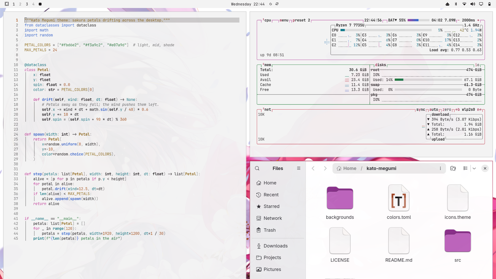
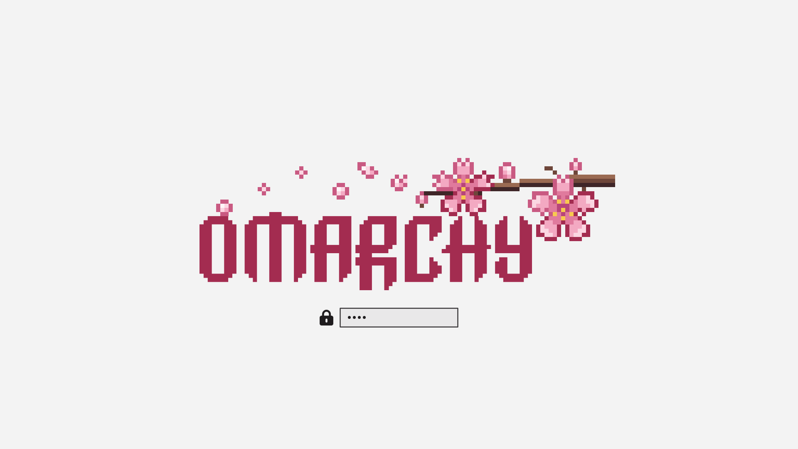

# Kato Megumi

A soft, readable light theme for [Omarchy](https://omarchy.org), inspired by Kato Megumi from *Saenai Heroine no Sodatekata*.



## Install

```bash
omarchy theme install https://github.com/SoujiOkita98/omarchy-kato-megumi-theme
```

Companion theme: **[Kato Megumi Dark](https://github.com/SoujiOkita98/omarchy-kato-megumi-dark-theme)**

## Design

- **Light** Omarchy theme inspired by Kato Megumi (Saekano): a crimson scarf and sakura petals.
- Neutral soft off-white background (`#f3f3f3`) with near-black text (15:1 contrast).
- Every color that can appear as text, including terminal colors and the dim gray, is at least **4.5:1** (WCAG AA) on the background.
- Terminal colors tuned in OKLCH for clearly distinct hues.
- Crimson accent and a crimson → sakura → lavender window-border gradient.
- Yaru-magenta icons.

## Boot screen

The theme ships a sakura pixel-art Omarchy logo (`unlock.png`). To use it on the
boot / disk-unlock screen:

```bash
omarchy plymouth set-by-theme kato-megumi
```



## Wallpapers

| # | File | Artist | Source |
|---|---|---|---|
| 1 | `01-O06_…28edg6.png` | Misaki Kurehito* | [wallhaven 28edg6](https://wallhaven.cc/w/28edg6) |
| 2 | `02-O04_…57mrj5.jpg` | Misaki Kurehito* | [wallhaven 57mrj5](https://wallhaven.cc/w/57mrj5) |
| 3 | `03-O05_…x1pgll.jpg` | Misaki Kurehito* | [saenai.tv](http://www.saenai.tv/) via [wallhaven x1pgll](https://wallhaven.cc/w/x1pgll) |
| 4 | `04-O07_…yjgl6g.jpg` | Misaki Kurehito* | [konachan](http://konachan.net/post/show/230025) via [wallhaven yjgl6g](https://wallhaven.cc/w/yjgl6g) |
| 5 | `05-O11_…d5plzm.jpg` | Misaki Kurehito* | [yande.re](https://yande.re/post/show/356486) via [wallhaven d5plzm](https://wallhaven.cc/w/d5plzm) |
| 6 | `06-F18_…yxqmkg.jpg` | unknown | [wallhaven yxqmkg](https://wallhaven.cc/w/yxqmkg) |
| 7 | `07-G09_…9mv5w1.png` | unknown | [wallhaven 9mv5w1](https://wallhaven.cc/w/9mv5w1) |
| 8 | `08-G05_…p2j28p.png` | official anime key visual (copyright notice on image) | [wallhaven p2j28p](https://wallhaven.cc/w/p2j28p) |
| 9 | `09-G11_…4xgkrd.jpg` | unknown | [wallhaven 4xgkrd](https://wallhaven.cc/w/4xgkrd) |

## Artwork & takedown

The wallpapers are **not** my work and are **not** covered by this repo's license.
Kato Megumi and *Saenai Heroine no Sodatekata* (Saekano) belong to Fumiaki Maruto,
Misaki Kurehito and their publishers. This is a free, non-commercial fan theme.

**Support the creators.** This theme exists because of Misaki Kurehito's illustrations
and Fumiaki Maruto's story. If you love Megumi too, please support the official
*Saekano* light novels, art books and Blu-rays.

\* Artist attributions come from Wallhaven's tags and have not been independently
verified. If you are the artist or rights holder of any image here and want it
credited differently or removed, please [open an issue](../../issues) and I will
fix it or take it down promptly.

The logo in `unlock.png` is the Omarchy logo (from the Omarchy project), recolored,
with original pixel-art sakura added.

## License

The theme files (`colors.toml`, `icons.theme`, and the sakura pixel art) are MIT
licensed; see [LICENSE](LICENSE). Artwork is excluded, as described above.
